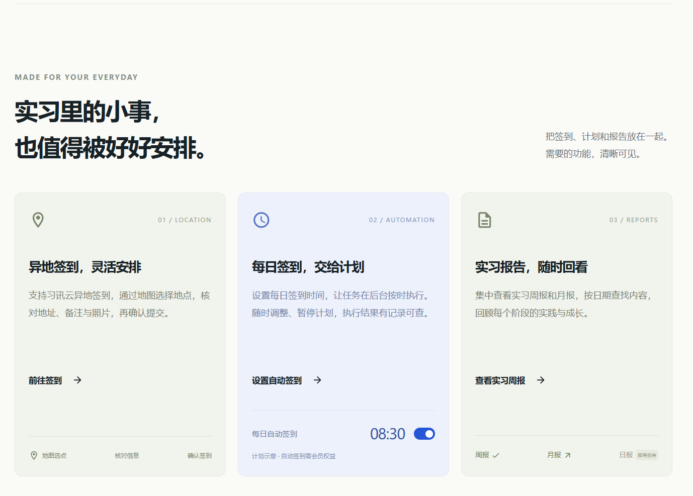

# 讯签到 · 习讯云实习签到工作台

## 正在用习讯云？打开网站，直接开始

### [👉 立即使用讯签到 · https://xqd.aist.ink](https://xqd.aist.ink)

**实习里的小事，也值得被好好安排。**

把习讯云签到、每日计划和实习报告放在一个工作台：地图选择签到地点，按需设置每日签到时间，随时回看签到记录、实习周报和月报。电脑、手机浏览器均可访问。

**[前往签到](https://xqd.aist.ink/#/sign) · [设置每日计划](https://xqd.aist.ink/#/sign?mode=daily) · [查看实习周报](https://xqd.aist.ink/#/reports/week)**

[](https://xqd.aist.ink)

> 希望直接使用？访问 **[xqd.aist.ink](https://xqd.aist.ink)**，无需自行安装和维护服务器。在线服务的功能与权益以网站说明为准；上图为在线网站展示。

---

## 社区开源版

这是讯签到的社区源码仓库，供学习、研究和自行部署。它是面向习讯云的独立第三方辅助工具，与习讯云官方无隶属关系。

[本次更新](docs/update-2026-11-09.md) · [本地运行](#本地运行) · [配置说明](#配置说明) · [AI 草稿与邮件提醒](#ai-草稿与邮件提醒) · [已有部署升级](#已有部署升级)

### 2026-11-09 更新

- **AI 报告草稿**：支持周报、月报单份起草和历史缺报批量生成，可停止、恢复及下载草稿，核对后再确认提交。
- **签到失败邮件提醒**：独立验证绑定接收邮箱，可暂停、更换或解除绑定；提醒最终失败及复核后仍无法确认的执行。
- **每日计划可靠性**：增加当日记录去重、只读预检查、提交结果复核和错过时段记录，避免重复提交。
- **配置由部署者提供**：AI 和 SMTP 均为可选服务，仓库不附带默认私有 AI 服务、真实密钥或运行数据。

### 功能范围

| 功能 | 社区版内容 |
| --- | --- |
| 习讯云账号连接 | 学校搜索、学号验证、账号绑定与会话恢复 |
| 签到记录 | 按月查询、日历展示、官方记录核对 |
| 地图选点签到 | 地点搜索、地址确认、备注与照片上传 |
| 每日签到计划 | 时间配置、暂停/恢复、编辑/删除、当日去重、预检查与结果复核、执行历史 |
| 实习报告 | 周报/月报列表、详情、草稿、附件与提交 |
| AI 报告草稿 | 单份起草、历史缺报查询、按周期批量生成、停止与本地恢复；审核后手动提交 |
| 签到失败邮件提醒 | 验证码绑定独立邮箱、暂停/更换/解除绑定、最终失败提醒 |
| 响应式界面 | React + TypeScript，兼容电脑与手机 |

**会员中心及其权益、兑换码、邀请奖励、充值、支付宝等实现，以及管理端页面、接口和数据模型不在本仓库发布范围内。** 社区版的每日计划可在自行部署的服务上独立运行，不依赖在线网站的会员系统。日报功能尚未实现。

## 技术与环境

- Go：版本以 [go.mod](go.mod) 为准（当前 `1.27.0`，工具链 `1.27.3`）。
- SQLite：使用 `mattn/go-sqlite3`，需要开启 CGO 并安装 C/C++ 编译工具链；Windows 可使用 MinGW-w64。
- Node.js：`20.19+` 或 `22.12+`，建议与 CI 一致使用 Node.js 22。
- React 19、TypeScript、Vite、MUI；后端使用 Gin、Cobra。

## 本地运行

```bash
git clone https://github.com/PZEHONG/xunqiandao-community.git
cd xunqiandao-community
```

将 `.env.example` 复制为 `.env`，自行申请并填写地图和人机验证配置。模板不包含任何真实凭证；请勿提交你的 `.env`、数据库或加密密钥。

```bash
cp .env.example .env

# 构建前端
cd frontend
npm ci
npm run build
cd ..

# 构建后端（Linux / macOS，需要 C/C++ 编译器）
CGO_ENABLED=1 go build -trimpath -mod=readonly -o output/xunqiandao main.go

# 启动本地服务
./output/xunqiandao serve --host 127.0.0.1 --port 8080
```

Windows 在完成前端构建后，从仓库根目录使用 PowerShell 编译和启动（需先将 MinGW-w64 等编译工具加入 `PATH`）：

```powershell
$env:CGO_ENABLED = '1'
go build -trimpath -mod=readonly -o output/xunqiandao.exe main.go
.\output\xunqiandao.exe serve --host 127.0.0.1 --port 8080
```

程序从**启动时的工作目录**读取 `.env` 并创建本地 `config.db`，请固定工作目录并妥善保存运行数据。后端会嵌入前端资源，因此应先构建前端，再构建后端。

打开 [http://127.0.0.1:8080](http://127.0.0.1:8080)，选择学校并使用自己的习讯云账号登录。`/api/health` 提供健康检查；`/legacy/` 保留旧版界面入口。

开发前端时，可在已启动后端的情况下于 `frontend` 运行 `npm run dev`，开发服务会代理本机 8080 端口的 API。

## 配置说明

| 配置 | 用途与要求 |
| --- | --- |
| `AMAP_WEB_KEY` | 地点搜索和逆地理编码，使用高德 Web 服务 Key |
| `AMAP_JS_KEY` | 高德地图 JS API Key |
| `AMAP_SECURITY_JS_CODE` | JS API 对应的安全密钥，由服务端代理使用 |
| `AMAP_DEFAULT_CITY` | 可选的默认搜索城市 |
| `GEETEST_CAPTCHA_ID` / `GEETEST_API_KEY` | 极验 GT4.0 人机验证配置 |
| `GEETEST_ENABLED` | 默认启用；仅本机隔离测试可设为 `false` |
| `REPORT_AI_BASE_URL` | 可选 AI 服务的 HTTPS 基础地址，程序追加 `/chat/completions`；无默认值 |
| `REPORT_AI_MODEL` | 部署者选择的模型名；无默认值 |
| `REPORT_AI_API_KEY` | 部署者申请的 AI 服务密钥；无默认值 |
| `SMTP_HOST` / `SMTP_PORT` | 可选邮件服务地址与端口，端口默认为 `465` |
| `SMTP_USERNAME` / `SMTP_PASSWORD` | 邮件服务账号和密码或授权码 |
| `SMTP_FROM` | 发件邮箱；留空时使用 `SMTP_USERNAME` |

AI 功能需要同时填写三项 `REPORT_AI_*` 配置，邮件功能需要可用的 SMTP 配置。未配置这两项可选服务时，普通签到、每日计划和手动报告仍可使用。SMTP 用于独立提醒邮箱的验证码和失败通知；网页不提供邮箱注册或找回密码入口。

所有密钥仅放在服务端环境变量或本地 `.env`，不要放入前端变量、构建参数、截图或公开仓库。AI 配置接口只返回是否就绪，不返回密钥、服务地址或模型。配置与使用详见 [AI 草稿和邮件提醒](docs/ai-reports-notifications.md)。对外部署还需配置 HTTPS、可信反向代理和持久化存储，见 [.env.example](.env.example)。

## AI 草稿与邮件提醒

### 生成并核对报告

1. 连接习讯云账号，进入周报或月报页面。编辑报告时使用“AI 起草”，或在列表中选择“AI补全”查询历史缺报。
2. 确认报告周期，填写真实的岗位、工作任务和学习收获；批量补全时勾选需要生成的周期。
3. 生成中可以停止，已有内容会保留为当前浏览器的草稿，也可下载备份。不同账号、学校的草稿独立保存。
4. 选择“载入编辑器核对”，检查日期、栏目及正文，补充真实细节后再明确确认提交。生成和载入草稿本身不会提交报告。

生成时，报告周期、学校栏目和填写的工作素材会发送给部署者配置的 AI 服务。请了解该服务的数据处理规则，避免输入无关的个人信息。清理浏览器数据或更换设备不会保留本地草稿，重要内容请先下载。

### 开启签到失败提醒

1. 部署者先完成 SMTP 和人机验证配置。
2. 用户进入“账号”页面的“签到提醒邮箱”，填写收件地址，完成人机验证并接收验证码。
3. 验证绑定后开启提醒；以后可在同一位置暂停、更换或解除绑定。

提醒只针对任务最终失败或复核后仍无法确认的结果，待复核期间不会立即发送失败邮件。已明确发送或发送结果不确定的同一封邮件不会自动重复发送；邮件异常不会触发重新签到。

## 每日计划如何执行

1. 连接账号并确认学校，选择地点、签到类型和时间。
2. 核对任务内容后明确确认启用，从下一个计划时刻开始执行。
3. 任务按北京时间每天运行（包含周末）；同一任务同一日期最多提交一次。提交前核对账号当日记录，已有签到则跳过；无法核验时不提交。
4. 任务在**你部署的服务端**执行。关闭网页不影响任务，但运行服务的电脑或服务器必须开机联网；服务停止、休眠期间错过的时刻不补签。
5. 任务执行前进行只读预检查，提交结果不明确时继续只读复核，并区分已签到、待复核、失败、取消和错过时段等状态；系统不会自动重试签到提交。
6. 已验证绑定且开启的提醒邮箱，可接收最终失败或复核后仍无法确认结果的通知。未配置 SMTP 或未绑定邮箱，不影响计划执行。

## 已有部署升级

1. 停止旧服务，备份原工作目录的数据库、本地配置和加密凭证文件；不要使用仓库模板覆盖自己的 `.env`。
2. 获取最新社区版源码，重新安装锁定的前端依赖，依次构建前端和后端。
3. 如需 AI 草稿或邮件提醒，使用自己的服务填写对应配置；从原工作目录启动新版程序。
4. 启动时会自动补齐新增表和必要字段。查看 `/api/health` 及已有任务，核对任务配置和执行状态；停机期间错过的时刻不补签。

完整的配置与迁移细节见 [AI 报告草稿与签到失败邮件提醒](docs/ai-reports-notifications.md)，本次变更见 [2026-11-09 更新说明](docs/update-2026-11-09.md)。

## 检查与测试

```bash
python scripts/check_public_release.py .
python -m unittest discover -s scripts -p "test_*.py"
go test ./...
go vet ./...

cd frontend
npm run lint
npm test
npm run build
```

发布范围检查需要 Python 3。`npm run build` 包含类型检查和正式资源的演示数据隔离检查。仓库还保留了 Playwright 测试和模拟数据，端到端测试需要本机 Chrome：

```bash
# 在 frontend 目录执行
npm run test:e2e
```

测试会自动启动独立前端开发服务，使用模拟接口验证 AI 草稿、邮箱设置、报告和每日计划等流程。测试数据均应为虚构数据，不要把真实账号放进测试文件。公开发布前还应按 [SECURITY.md](SECURITY.md) 对暂存内容及 Git 历史执行秘密扫描。

## 源码结构

```text
frontend/       React 工作台与组件测试
web/            HTTP API、AI 报告与周期查询、会话检查、静态资源
platformauth/   用户登录、账号与提醒邮箱绑定、人机验证、会话、邮件发送
autosign/       每日计划、预检查、执行复核、历史记录与邮件通知队列
service/        习讯云业务接口与实现
utils/          SQLite、账号存储、凭证保护
cmd/            命令行功能
internal/wire/  依赖装配
scripts/        开源发布范围检查
docs/           更新记录、配置与迁移说明
```

## 安全与使用边界

请仅使用自己的账号，遵守学校、实习单位与平台的签到要求。签到和报告是否有效，以习讯云官方记录及学校要求为准。

项目不调用浏览器设备定位，使用用户确认的候选地点。密码等续期凭证由本地加密存储保护，数据库、会话文件、图片附件仍需由部署者妥善保管。不要在 Issue、截图、日志或 Pull Request 中公开账号、Cookie、Token、密钥或个人资料。发现安全问题请参考 [SECURITY.md](SECURITY.md)。

## 许可证与致谢

沿用项目已有的 [GNU GPL v3.0](LICENSE) 许可证。Berry Free React 模板相关部分保留 MIT 许可证，见 [第三方来源](frontend/THIRD_PARTY.md) 与 [Berry 许可证](frontend/licenses/berry-LICENSE)。

觉得有帮助，欢迎 Star、反馈问题和贡献改进。也欢迎直接使用 **[讯签到在线工作台](https://xqd.aist.ink)**。
